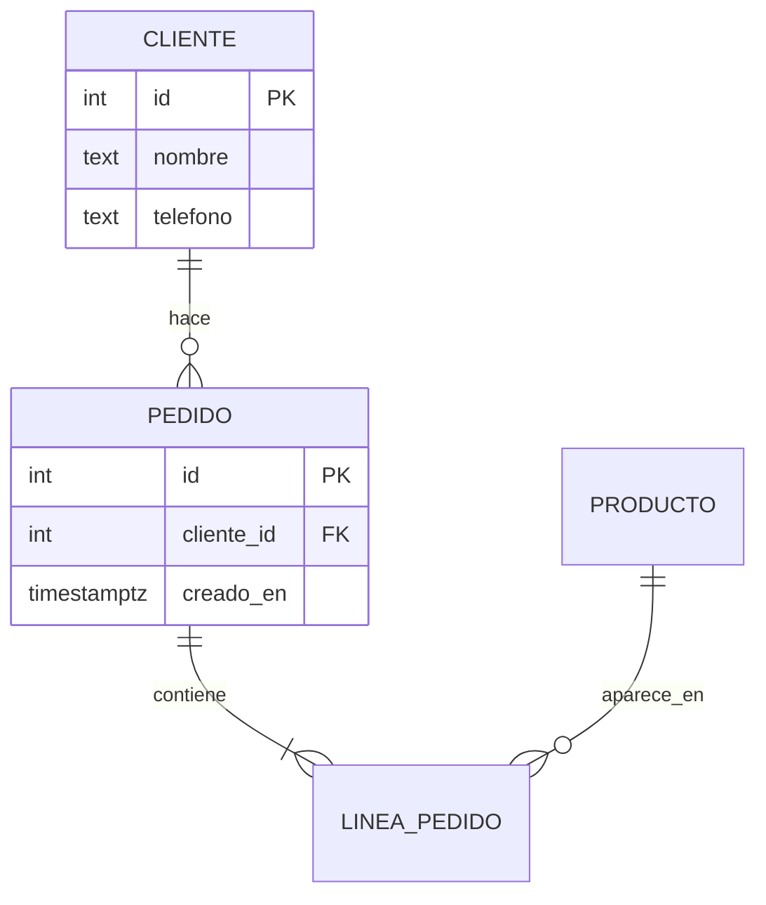

# PRD · <Nombre de tu producto>

> Documento de requisitos del producto (Product Requirements Document).
> Complétalo en el Sprint 0 (historia H0.3) y pide la aprobación del profesor en un Issue.
> Cada requisito funcional (RF) se convierte en un Issue con la plantilla "Historia de usuario".

| Campo | Valor |
| --- | --- |
| Alumno | |
| Proyecto n.º | |
| Sitio de referencia | |
| Compañero revisor | |
| URL desplegada | (se completa en el Sprint 5) |

## 1. Problema

¿Qué problema real resuelve y a quién le duele? (3 a 5 líneas)

## 2. Usuarios

- **Usuario principal:** quién es, qué necesita, desde qué dispositivo entra.
- **Usuario secundario:**

## 3. Objetivo y métrica de éxito

Ejemplo: «Un bodeguero registra una venta en menos de 10 segundos».

## 4. Alcance del MVP

Entre 5 y 8 funcionalidades que SÍ entran este semestre.

1.
2.
3.

### Funcionalidades → carpetas de `src/` (screaming architecture)

Cada funcionalidad del alcance será una carpeta en `src/`. Nómbralas en inglés y en plural.

| Funcionalidad | Carpeta |
| --- | --- |
| Ejemplo: ventas | `src/sales` |
| | |

## 5. Fuera de alcance

Lo que NO vas a construir.

-

## 6. Requisitos funcionales

| ID | Requisito | Prioridad (alta, media, baja) |
| --- | --- | --- |
| RF-01 | | |
| RF-02 | | |

## 7. Requisitos no funcionales

- Responsive, móvil primero (375 px y 1280 px).
- Lighthouse ≥ 90 en Accesibilidad y Buenas prácticas.
- 0 errores en la consola del navegador.
- Funciona con 10.000 registros sin congelarse.

## 8. Modelo de datos

Diagrama entidad-relación y tablas PostgreSQL con tipos, claves y restricciones.
GitHub dibuja diagramas Mermaid; edita este ejemplo:

## 9. Reto técnico distintivo

El que te tocó en el catálogo y cómo piensas resolverlo.

## 10. Riesgos y preguntas abiertas

-
