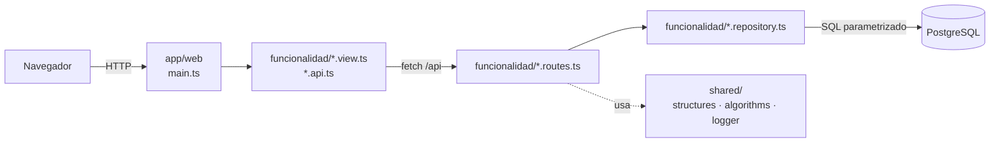

# Arquitectura · Screaming architecture

Este proyecto usa **screaming architecture** (arquitectura que grita): al abrir `src/` se entiende
**de qué trata el producto**, no con qué tecnología está hecho. Cada carpeta de primer nivel es una
**funcionalidad del negocio**, y cada funcionalidad contiene todo lo suyo: modelo, SQL, API y pantalla.

> El término viene de Robert C. Martin: así como el plano de una casa "grita" *cocina*, *dormitorio*,
> *baño*, la estructura de un sistema debe gritar *ventas*, *inventario*, *clientes*, no
> *controllers*, *models*, *services*.

## Estructura

```
src/
├── tasks/                  ← FUNCIONALIDAD de ejemplo: reemplázala por las tuyas
│   ├── task.model.ts       tipos + validación Zod (los usan la API y el frontend)
│   ├── task.repository.ts  SQL escrito a mano y parametrizado
│   ├── task.routes.ts      endpoints HTTP de la funcionalidad
│   ├── task.api.ts         llamadas del frontend a esos endpoints
│   └── task.view.ts        pantalla (DOM)
├── shared/                 ← lo técnico y reutilizable, sin reglas de ningún negocio
│   ├── config.ts  db.ts  logger.ts  http-client.ts  operation-log.ts
│   ├── structures/         tus estructuras de datos (E3): pila, lista, cola, tabla hash
│   └── algorithms/         tus algoritmos (E4): ordenamiento, búsqueda, benchmark
└── app/                    ← arranque: conecta las funcionalidades
    ├── server.ts           arranca la API y maneja las señales (SIGINT, SIGTERM)
    ├── create-app.ts       monta las rutas de cada funcionalidad
    └── web/                index.html, main.ts (arranca las pantallas), styles.css
```

## Cómo se ve en un producto real

Ejemplo, proyecto 1 · *Punto de venta para bodega*:

```
src/
├── products/      catálogo, código de barras, precios
├── inventory/     existencias, entradas, ajustes
├── sales/         venta, carrito, deshacer (usa shared/structures/stack.ts)
├── customers/     clientes y su historial
├── reports/       reporte de ventas con JOIN y gráfico en Canvas
├── auth/          registro, inicio de sesión y roles
├── shared/
└── app/
```

Sin leer una línea de código se sabe que es un sistema de ventas. Con capas técnicas
(`controllers/`, `models/`, `services/`) podría ser cualquier cosa.

## Reglas

| Regla | Por qué |
| --- | --- |
| Una carpeta por funcionalidad, con nombre del negocio en inglés y en plural (`sales`, `appointments`) | La estructura cuenta qué hace el producto |
| Cada funcionalidad tiene su `*.model.ts` | Sus tipos son el contrato entre API, base de datos y pantalla |
| Prohibidas en `src/` las carpetas por capa técnica: `controllers`, `models`, `services`, `routes`, `views`, `utils`, `lib`, `server`, `web`… | Repartirían una funcionalidad en cinco lugares |
| `shared/` no importa nada de ninguna funcionalidad | Lo compartido no puede depender del negocio |
| Las funcionalidades no importan nada de `app/` | `app/` conecta las funcionalidades, no al revés |
| Una funcionalidad puede usar otra solo a través de su `*.model.ts` o su repositorio | Así el acoplamiento se ve y se controla |
| Las migraciones viven en `db/migrations/` | PostgreSQL necesita un único orden de migraciones |

`tests/unit/architecture.test.ts` comprueba estas reglas en cada `npm test` y en la CI. Si alguien crea
`src/controllers/`, la CI queda en rojo.

## Cómo agregar una funcionalidad nueva

1. Crea la carpeta: `src/sales/`.
2. `sale.model.ts`: tipos y esquema Zod.
3. Migración `db/migrations/00N_sales.sql` con sus tablas.
4. `sale.repository.ts`: el SQL.
5. `sale.routes.ts`: los endpoints. Móntalos en `src/app/create-app.ts`: `app.use('/api/sales', …)`.
6. `sale.api.ts` y `sale.view.ts`: la pantalla. Arráncala en `src/app/web/main.ts`.
7. Pruebas en `tests/integration/sales.api.test.ts`.

## Diagrama



Actualiza esta sección con las funcionalidades de tu producto (historia H2.1).
